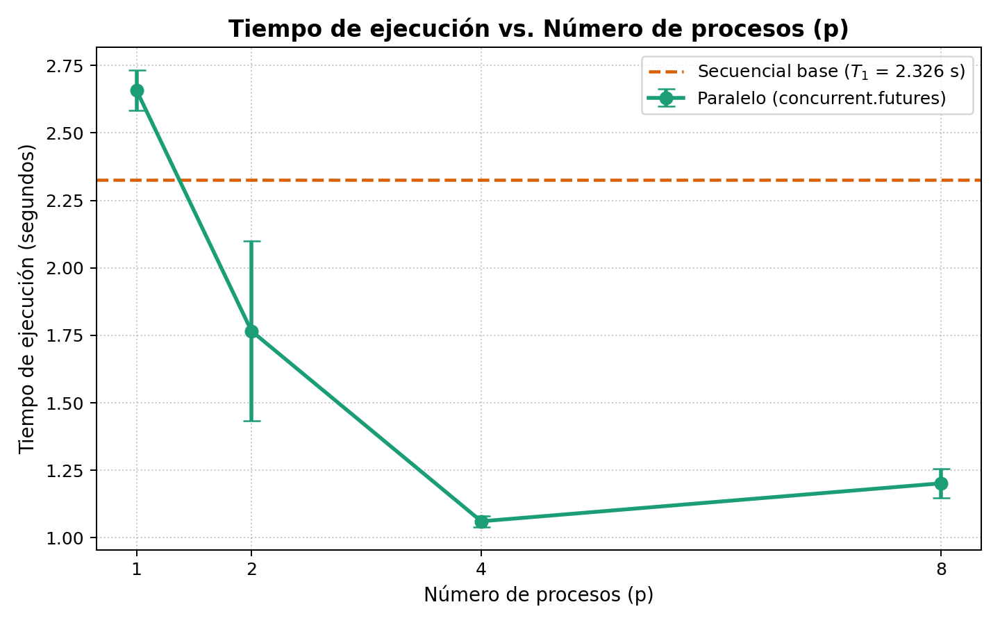
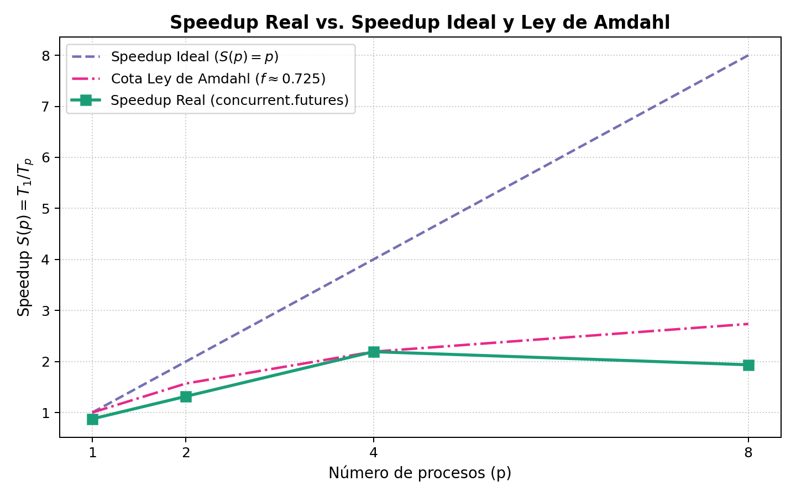
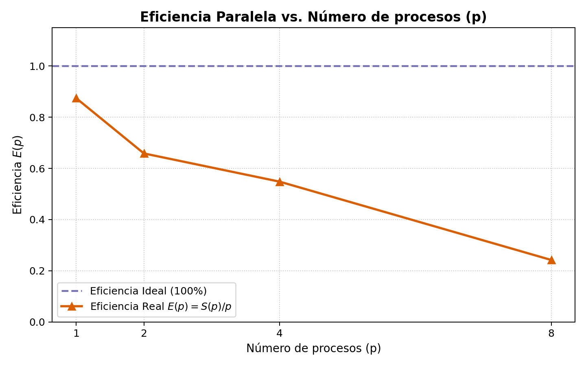

# MapReduce de palabras frecuentes en textos de México

## Objetivo
Contar cuántas veces aparece cada palabra en el campo `text` de los registros JSON dentro de un archivo ZIP, comparando una versión secuencial de referencia contra modelos paralelos.

## Flujo
- **Map**: transformar cada palabra en el par `(palabra, 1)`.
- **Reduce**: agrupar y sumar los valores de cada palabra.
- **Paralelismo con `concurrent.futures`**: dividir el procesamiento entre múltiples procesos (`ProcessPoolExecutor`), combinar los conteos parciales y verificar que el resultado coincida exactamente con la versión secuencial.
- **Comparación y mediciones**: evaluar el rendimiento con 1, 2, 4 y 8 procesos con al menos 3 repeticiones por configuración, calculando tiempo medio, desviación estándar, *speedup*, eficiencia y fracción paralelizable estimada con la Ley de Amdahl.

## Dataset
Los archivos JSON están dentro de un ZIP. **No subir el ZIP ni los datos JSON a Git**.
El programa los lee por *streaming* (`ijson`) para no cargar todo el dataset descomprimido en memoria.

## Convenciones iniciales
- Convertir palabras a minúsculas (`casefold`) y conservar letras acentuadas.
- Ignorar signos de puntuación, números y guiones bajos; no excluir palabras vacías (*stopwords*).
- Mostrar las 20 palabras más frecuentes.

---

## Instalación y Pruebas

Instala las dependencias y ejecuta las pruebas unitarias (secuencial y paralela):

```bash
python -m pip install -r requirements.txt
python -m unittest discover -s tests -v
```

---

## Ejecución

### 1. Versión secuencial (referencia)

```bash
python -m src.sequential /ruta/a/mx.zip
```

Esta versión lee los registros del ZIP uno por uno, sin extraer los JSON a disco.

### 2. Versión paralela con `concurrent.futures`

Para ejecutar el conteo paralelo con `ProcessPoolExecutor` (por defecto 4 procesos) y comprobar automáticamente que el resultado coincida con la versión secuencial (`--verify`):

```bash
python -m src.parallel_futures /ruta/a/mx.zip --workers 4 --verify
```

Opciones disponibles:
- `--workers` / `-w`: número de procesos paralelos (`1`, `2`, `4`, `8`, etc.).
- `--batch-size` / `-b`: tamaño de lote de registros cuando se reparte por lotes (predeterminado: `1000`).
- `--strategy`: estrategia de partición (`auto`, `members` o `batches`).
- `--top`: cantidad de palabras más frecuentes a imprimir (predeterminado: `20`).
- `--verify`: compara el conteo total contra `count_words_sequential` para verificar exactitud.

### 3. Reproducir experimentos y gráficas (1, 2, 4 y 8 procesos)

Para ejecutar las mediciones completas (3 repeticiones para secuencial y para `p = 1, 2, 4, 8` procesos), verificar correctitud en cada corrida y generar el CSV y las gráficas en `resultados/`:

```bash
python -m src.benchmark_futures /ruta/a/mx.zip --workers 1 2 4 8 --repetitions 3 --output-dir resultados
```

> **Nota de reproducibilidad**: Si no se cuenta con `/ruta/a/mx.zip` en la ruta indicada (por defecto `data/mx.zip`), `src.benchmark_futures` genera automáticamente un dataset local de prueba en `data/mx.zip` (16 archivos JSON × 5,000 registros = 80,000 registros y ~8.12 millones de palabras, ignorado por Git) para poder reproducir todas las mediciones de inmediato.

---

## Especificaciones del Equipo de Cómputo Utilizado

| Componente | Especificación |
| :--- | :--- |
| **Procesador (CPU)** | Apple M1 (ARM64) |
| **Núcleos físicos / lógicos** | 8 núcleos físicos (4 de alto rendimiento *Firestorm* + 4 de alta eficiencia *Icestorm*) / 8 hilos lógicos |
| **Memoria RAM** | 8.0 GB de memoria unificada |
| **Sistema Operativo** | macOS (Darwin arm64) |
| **Versión de Python** | Python 3.12.3 |
| **Bibliotecas clave** | `ijson 3.6.0`, `concurrent.futures` (estándar), `matplotlib 3.10.3` |

---

## Resultados Experimentales (`concurrent.futures`)

Experimentos realizados sobre un archivo comprimido (`data/mx.zip`) con **80,000 registros JSON** distribuidos en 16 archivos internos (`8,121,492` palabras totales), ejecutando **3 repeticiones por configuración** y midiendo con `time.perf_counter()`. En el 100 % de las ejecuciones se verificó que el diccionario completo de frecuencias (`Counter`) coincide exactamente con la versión secuencial.

### Fórmulas Aplicadas

- **Speedup**:
  $$S(p) = \frac{T_1}{T_p}$$
  donde $T_1$ es el tiempo medio secuencial base y $T_p$ el tiempo medio con $p$ procesos.
- **Eficiencia**:
  $$E(p) = \frac{S(p)}{p}$$
- **Ley de Amdahl** (cota teórica y estimación de fracción paralelizable $f$):
  $$S(p) \leq \frac{1}{(1 - f) + \frac{f}{p}} \implies f = \frac{1 - \frac{1}{S(p)}}{1 - \frac{1}{p}}$$

### Tabla de Métricas (Secuencial vs. `concurrent.futures`)

| Versión / Modelo | Procesos ($p$) | Corrida 1 (s) | Corrida 2 (s) | Corrida 3 (s) | Media $T_p$ (s) | Desv. Estándar (s) | Speedup $S(p)$ | Eficiencia $E(p)$ | Fracción Paralela $f$ (Amdahl) | Speedup Teórico Amdahl ($f = 0.7252$) | Correctitud vs. Secuencial |
| :--- | :---: | :---: | :---: | :---: | :---: | :---: | :---: | :---: | :---: | :---: | :---: |
| **Secuencial (base)** | 1 | 2.2889 | 2.2916 | 2.3980 | **2.3262** | 0.0622 | **1.0000** | **1.0000** (100.0%) | — | 1.0000 | Referencia |
| **`concurrent.futures`** | 1 | 2.7440 | 2.6172 | 2.6130 | **2.6581** | 0.0745 | **0.8751** | **0.8751** (87.5%) | — | 1.0000 | Exacto (`OK`) |
| **`concurrent.futures`** | 2 | 1.5748 | 2.1513 | 1.5725 | **1.7662** | 0.3335 | **1.3170** | **0.6585** (65.9%) | 0.4814 | 1.5688 | Exacto (`OK`) |
| **`concurrent.futures`** | 4 | 1.0847 | 1.0495 | 1.0490 | **1.0610** | 0.0205 | **2.1923** | **0.5481** (54.8%) | **0.7252** | 2.1923 | Exacto (`OK`) |
| **`concurrent.futures`** | 8 | 1.2267 | 1.2388 | 1.1399 | **1.2018** | 0.0539 | **1.9356** | **0.2419** (24.2%) | 0.5524 | 2.7360 | Exacto (`OK`) |

*(Datos exportados también en [`resultados/metrics_futures.csv`](resultados/metrics_futures.csv)).*

---

## Gráficas de Rendimiento

### 1. Tiempo de Ejecución vs. Número de Procesos


### 2. Speedup Real vs. Speedup Ideal y Cota de la Ley de Amdahl


### 3. Eficiencia Paralela vs. Número de Procesos


---

## Interpretación de Resultados y Relación con la Ley de Amdahl

1. **Sobrecarga con $p = 1$ ($S(1) = 0.8751$)**:
   Al ejecutar `ProcessPoolExecutor` con un solo proceso trabajador, el tiempo medio aumenta ligeramente de `2.3262 s` a `2.6581 s`. Esto se debe a la sobrecarga fija (*overhead*) de crear el proceso hijo en macOS (método `spawn`), inicializar el intérprete de Python, serializar (`pickle`) las tareas/resultados a través de tuberías IPC y combinar los diccionarios `Counter` en el proceso padre.
2. **Escalamiento óptimo en $p = 4$ ($S(4) = 2.1923$, $f \approx 72.5\%$)**:
   Con 4 procesos se alcanza el menor tiempo de ejecución (`1.0610 s ± 0.0205 s`), logrando más del doble de velocidad respecto a la versión secuencial. A partir de este punto se estima una fracción paralelizable efectiva de $f = 0.7252$ (72.52 % del trabajo es efectivamente paralelizable y el 27.48 % restante actúa como fracción secuencial e IPC). Según la Ley de Amdahl, con $f = 0.7252$ el *speedup* máximo asintótico cuando $p \to \infty$ es:
   $$S_{\max} = \frac{1}{1 - 0.7252} \approx 3.64\times$$
3. **Cuellos de botella al pasar de $p = 4$ a $p = 8$ ($S(8) = 1.9356$)**:
   En el procesador **Apple M1**, de los 8 núcleos totales, solo **4 son núcleos de alto rendimiento (*Performance cores*)** y los otros **4 son núcleos de alta eficiencia energética (*Efficiency cores*)** con menor frecuencia de reloj. Al lanzar 8 procesos simultáneos:
   - Se presenta **arquitectura heterogénea y desbalance de velocidad** entre núcleos P y núcleos E.
   - Aumenta la **contención por lectura/descompresión sobre el mismo archivo ZIP** y el ancho de banda de memoria unificada.
   - Crece el costo de creación (`spawn`) de 8 procesos y la reducción final secuencial de los conteos parciales en el proceso principal.
   Por ello, $p = 4$ aprovecha los 4 núcleos de alto rendimiento de forma óptima sin saturar el subsistema de I/O ni incurrir en sobrecarga adicional de planificación.
